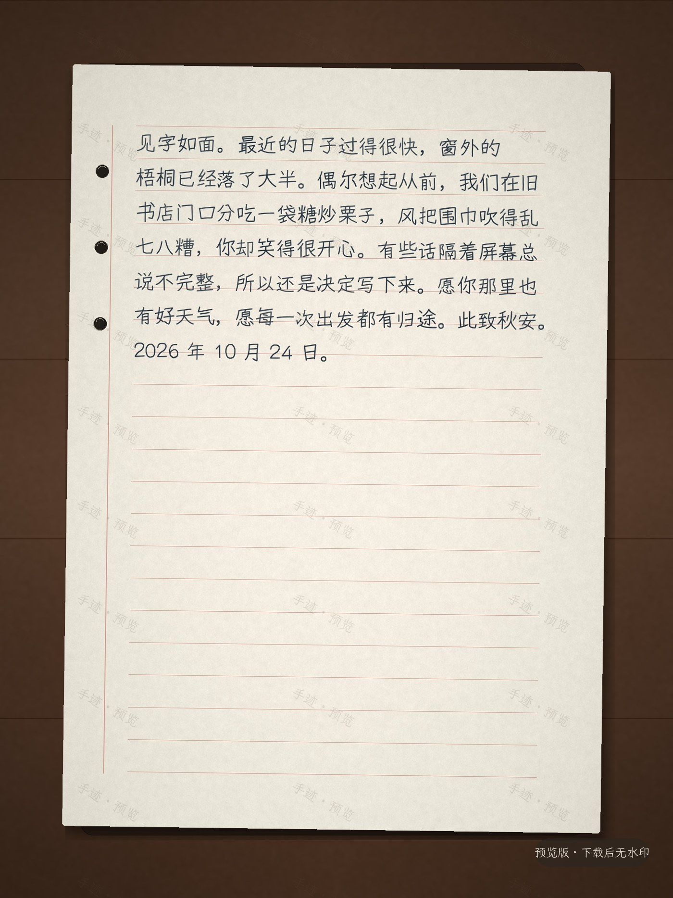

# chaos-garden

> Where my half-baked ideas get baked.

个人实验场 / 半成品收容所。这里放着我用 AI 辅助写的一些小项目，每个项目一个独立文件夹，没有统一的构建体系，按需单独安装依赖、单独运行。

## 导航

| 项目 | 一句话 | 技术栈 | 运行 |
| :--- | :--- | :--- | :--- |
| [ContributorRank](#contributorrank) | 跨平台开源贡献度分析桌面应用，透明加权评分 | Tauri 2.8 · Rust · React 18 · TypeScript | `npm install && npm run tauri dev` |
| [house_game · 禅庭](#house_game--禅庭) | 可走进去的日式枯山水庭院，全程序化生成 | Three.js 0.170 · GLSL · WebAudio | `python -m http.server 8000` |
| [chronoscope](#chronoscope) | Git 仓库时间旅行：拖动时间轴看代码城市生长 | Tauri 2.12 · Rust · React 18 · Three.js 0.186 | `npm install && npm run tauri dev` |
| [redquill](#redquill) | LLM 驱动的越狱探测：双通道判定 + 防御建议 | Tauri 2.12 · Rust · React 18 · Three.js 0.186 | `npm install && npm run tauri dev` |
| [gestura · 手迹](#gestura--手迹) | 摄像头追踪手部关键点，食指即笔：速度定粗细、伸展定抬落、拇指定桩 | MediaPipe Hands · Canvas 2D · 原生 ESM | `python serve.py 8000` |
| [glyphbestiary · 字兽录](#glyphbestiary--字兽录) | 手绘的字演化出一个物种：200 个体按楷行草狂分生态位，手抖即变异 | MediaPipe Hands · Canvas 2D · 原生 ESM | `python serve.py 8020` |
| [inkmark · 手迹](#inkmark--手迹) | 文字转手写工作台：8 款字体 / 11 种纸张 / OCR / 600 DPI | FastAPI · Pillow · React 19 · TypeScript | `cd inkmark; scripts\run.ps1` |
| [douyi · 斗文台](#douyi--斗文台) | AI 互斗观测站：两台机器同席，辩论、飞花令与成语接龙 | 原生 ESM · Node SSE 代理 · 零构建 | `npm start` |

<details>
<summary><b>目录结构</b></summary>

```text
chaos-garden/
├─ ContributorRank/        # 开源贡献度分析桌面应用（Tauri + Rust + React）
├─ house_game/             # 禅庭 · Three.js 枯山水互动场景（零构建，无依赖安装）
├─ chronoscope/            # Git 代码考古 · 3D 城市时间轴（Tauri + React + Three.js）
├─ redquill/               # LLM 越狱探测 · 双通道判定 + 防御建议（Tauri + Rust + React + Three.js）
├─ gestura/                # 手迹 · 摄像头手势绘画（零构建 · 311 项 Node 测试）
├─ glyphbestiary/          # 字兽录 · 演化的手写体物种（零构建 · 7 组 Node 测试）
├─ douyi/                  # 斗文台 · AI 互斗观测站：辩论 + 飞花令 + 成语接龙（零构建 · 51 项 Node 测试）
└─ inkmark/                # 手迹 · 文字转手写工作台：字体 / 纸张 / OCR / 高清导出（FastAPI + React）
```

</details>

---

<a id="contributorrank"></a>

## ContributorRank

一个跨平台的**开源贡献度分析工具**：抓取 GitHub / GitLab / 本地 Git 仓库的提交数据，用可配置权重把 Commit、LoC、PR、Issue、Review 汇总成一份透明的贡献排行榜。

<details>
<summary><b>技术栈</b></summary>

| 层 | 选型 |
| --- | --- |
| 桌面壳 | Tauri 2.8 |
| 后端 | Rust（`reqwest` + `serde` + SQLite 缓存） |
| 前端 | React 18 + TypeScript + Vite 6 |
| 样式 | Tailwind CSS 3 + shadcn/ui 风格组件 |
| 状态 / 图表 / 路由 | Zustand · Recharts · React Router |
| 图标 | lucide-react |

</details>

<details>
<summary><b>核心能力</b></summary>

- **三数据源**：GitHub REST API、GitLab REST API、本地 `git log --numstat`（离线可用）
- **六项指标**：`commits`、`loc`（增删行数）、`prs`、`mergedPrs`、`closedIssues`、`reviews`
- **透明评分**：`score = Σ(weight_i × metric_i / max(metric_i))`，权重滑块实时重算，不重复请求远端
- **身份归并**：同一 contributor 的多平台账号合并为一条记录
- **本地优先**：Token 与设置只存在本机 `settings.json`，远端快照缓存在 `cache.sqlite`
- **可视化**：排行榜表格/卡片、贡献趋势、指标占比饼图、事件时间线

</details>

<details>
<summary><b>评分公式</b></summary>

```text
score = Σ( weight_i × metric_i / max(metric_i) )
```

权重范围 `0 ~ 2`，`0` 表示忽略该指标。调整权重只触发本地重排序，不触发重新抓取。

</details>

<details>
<summary><b>运行</b></summary>

```bash
cd ContributorRank
npm install
npm run tauri dev      # 桌面开发窗口
npm run tauri build    # 构建当前平台安装包
```

依赖：Node.js 20+、Rust stable、以及对应平台的 [Tauri prerequisites](https://v2.tauri.app/start/prerequisites/)。

</details>

更详细的设计说明、目录职责与后续迭代计划，见 [`ContributorRank/README.md`](ContributorRank/README.md)。

---

<a id="house_game--禅庭"></a>

## house_game · 禅庭

一座可以走进去的**日式枯山水庭院**：白砂、石组、五重宝塔、盘旋青龙，四个季节与一整套可交互器物，**全部程序化生成**——没有模型文件、没有贴图素材、没有音频文件。

<details>
<summary><b>技术栈</b></summary>

| 层 | 选型 |
| --- | --- |
| 渲染 | Three.js 0.170（WebGLRenderer、ACESFilmic、PCFSoft 阴影） |
| 相机 | OrbitControls（阻尼 / 环游 / 跟随龙） |
| 着色 | GLSL ES 3.0（砂面、天空、水面、积雪 patch） |
| 贴图 | 运行时 Canvas 生成（砂纹高度图、光晕、噪声） |
| 音频 | WebAudio 实时合成 |
| 模块 | 原生 ESM + importmap，无打包器 |

</details>

<details>
<summary><b>核心玩法</b></summary>

- **耙砂**：拖动即在白砂上耙出砂纹，耙砂僧会同步跟着耙
- **投石**：点击白砂泛起同心涟漪
- **四季**：`1`–`4` 切换春樱 / 夏雨 / 秋枫 / 冬雪，环境色连续插值过渡
- **昼夜**：`N` 切换，灯笼自动点亮；`F` 跟随青龙飞行
- **器物**：宝塔风铃可撞响、青龙会喷火、石灯笼可点灭、鹿威蹲踞会流水、屋顶有猫

</details>

<details>
<summary><b>运行</b></summary>

```bash
cd house_game
python -m http.server 8000     # ES Module 需经 HTTP 打开，file:// 会被 CORS 拦截
```

无 `npm install`，无构建步骤。`three` 由 importmap 指向 CDN，改版本只需动 `index.html` 一行。

</details>

场景架构、几何算法、着色器、交互系统与模块拆分详见 [`house_game/README.md`](house_game/README.md)。

---

<a id="chronoscope"></a>

## chronoscope

把任意 Git 仓库变成一座**可以拖着时间轴看它长大的 3D 城市**：每个文件一栋楼，高度是行数、颜色是语言、位置由路径决定且整个历史中不跳变。拖动或自动播放时间轴，看项目从几个文件长成今天的样子。完全离线，不发任何网络请求。

> 分阶段交付中：Phase 0（3D 城市、时间轴、自动播放）与 Phase 1（真实 `git2` 扫描器）已完成，启动后选一个本地 Git 仓库即可。

<details>
<summary><b>技术栈</b></summary>

| 层 | 选型 |
| --- | --- |
| 桌面壳 | Tauri 2.12（Rust） |
| 前端 | React 18 + TypeScript + Vite 6 |
| 3D | three 0.186：单个 InstancedMesh、OrbitControls、UnrealBloom |
| 图表 | 时间轴面积图 Canvas 手绘 |
| Git / 缓存 | `git2` 读本地 `.git` · JSON 文件缓存（blob OID 去重） |

</details>

<details>
<summary><b>核心能力</b></summary>

- **稳定布局**：目录深度分带、带内字典序，对整个历史的路径并集只算一次
- **对数缩放**：高度与占地都按 `log1p(行数)`，大文件不会压扁整座城
- **连续时钟**：播放位置是小数坐标而非 commit 计数，过渡带径向错峰，能停在任意位置
- **真实仓库**：`git2` 离线读 `.git`，blob OID 去重缓存，线上只传增量
- **自动播放**：`空格` 播放 / 暂停，`0.5×`–`4×` 调速，拖动时间轴自动暂停
- **交互**：悬停看文件、点击看修改史、`/` 搜索提交、`←` `→` 逐 commit、载入时生长入场、`B` 二分查找（`log2(n)` 问定位 culprit 并高亮嫌疑文件）
- **实测帧率**：10 万方块 73.8 fps / 13.55 ms 帧耗时，draw calls 恒为 21
- **规划中**：逐 commit 搜索、`diff_tree_to_tree` 扫描优化

</details>

<details>
<summary><b>运行</b></summary>

```bash
cd chronoscope
npm install
npm run tauri dev      # 桌面开发窗口
npm run tauri build    # 构建当前平台安装包
```

依赖：Node.js 20+、Rust stable、以及对应平台的 [Tauri prerequisites](https://v2.tauri.app/start/prerequisites/)。

</details>

阶段规划、视觉编码、目录职责与实现要点详见 [`chronoscope/README.md`](chronoscope/README.md)。

---

<a id="redquill"></a>

## redquill

一个 **LLM 驱动的越狱探测工具**：16 个攻击族模板库 + 12 个变异算子的遗传搜索，判定层是**双通道**的（启发式 + N 票判定模型），输出带置信度的结论和**按严重度排序的防御建议**。只针对你自己拥有或已获授权测试的端点。

它的立场是「判定层才是主体」：现成工具的结论要么来自一条关键词正则，要么来自单次 LLM 调用，两者都给你一个不可复现的 bool。redquill 输出标签 + 置信度 + 通道一致度 + 投票一致度，**两个通道矛盾时标记为分歧而不是取平均**，并且每条记录都保存完整对话与原始响应，报告里的每条发现都能一键复制成手工复现脚本。

<details>
<summary><b>技术栈</b></summary>

| 层 | 选型 |
| --- | --- |
| 桌面 | Tauri 2.12 |
| 后端 | Rust · `reqwest`（rustls）· `tokio` |
| 前端 | React 18 + TypeScript + Vite 6 |
| 3D | Three.js 0.186（无 OrbitControls，手写轨道控制） |
| 持久化 | 每运行一份 JSON（无数据库） |

</details>

<details>
<summary><b>三个设计决定</b></summary>

- **二进制里不含载荷语料**：攻击库只提供策略框架，实际被测行为由运行时填入并代入模板，因此适用于任何策略边界，也不用等工具更新就能测新模型。
- **适应度里「不确定」拿 0 而非负分**：惩罚不确定会让进化朝「判定模型读不懂的探测」优化——那是在优化判定噪声。`disputed` 额外 ×0.5，因为它只是线索。
- **每一代都留裸请求基线**：没有基线就无法区分「包装有效」和「本来就能过」，而这个区分决定报告里最严重那条发现是否成立。

</details>

<details>
<summary><b>能力</b></summary>

- **双通道判定**：启发式通道（离线、确定性、列出命中标记）＋ N 票判定模型通道（明确 rubric、每票带理由），融合出置信度
- **遗传搜索**：精英保留 + 锦标赛选择 + 算子交叉，按家族+算子组合的新颖度给奖励，固定种子可完整复现
- **3D 攻击树**：半径 = 代数，扇区 = 攻击族，柱高 = 适应度；「某个扇区里一簇高红柱」是最可操作的形状，表格视图会把它藏起来
- **防御报告**：每条发现指名机理 + 给出部署层修改，并列出证据 probe id；还覆盖输出侧规避编码、判定通道分歧、样本量不足这三类容易被忽略的问题
- **LLM 改写器**（可选）：让模型改写高分离子，加速突破
- **历史**：每次运行落一份完整 JSON，保留最近 200 条

</details>

92 个 Rust 单测覆盖判定融合、启发式分类、算子合法性、进化确定性与报告生成，全部离线可跑。详见 [`redquill/README.md`](redquill/README.md)。

---

<a id="gestura--手迹"></a>

## gestura · 手迹

一个**实时**的手势绘画装置：摄像头进，画面出，中间没有录制和回放。**食指伸出即落墨**，蜷起抬笔；移动手画线，慢则粗快则细，手张得越开笔画越饱满。

每个笔点是四元组：**位置**（食指尖）决定走向、**速度**（位置差分）决定粗细与干湿、**食指伸展比**（食指尖→腕 ÷ 食指 PIP→腕）决定抬落、**五指开合**决定笔宽饱满度。

落墨看的是**食指**而不是整只手张开程度——这是实测出来的设计错误：早期版本用整体开合度同时管落墨和笔宽，结果最自然的写字姿态（食指伸出、其余三指蜷起）开合度只有 0.18，被判成抬笔，什么都不画。两个阈值之间留了迟滞窗口，否则手指在边界抖动会让笔画出现一串散点。

平滑用 **One-Euro 滤波**而非固定速率指数平滑：固定系数只能在「去抖」与「不滞后」之间取折中，800px/s 匀速实测下峰值滞后 55.1px vs 8.8px，抖动还更小。

检测只在摄像头出新帧时跑（通常 30/s），而渲染快得多 —— 直接用检测坐标会让笔**以 30 次/秒阶梯跳动**，渲染再高都没用。按渲染率重采样后（插值 + 有上限的外推），实测 99.2% 的渲染帧都拿到新位置。

<details>
<summary><b>技术栈</b></summary>

| 层 | 选型 |
| --- | --- |
| 手部追踪 | MediaPipe Tasks Vision 0.10.14（`HandLandmarker`，VIDEO 模式，GPU delegate，失败自动回退 CPU） |
| 渲染 | Canvas 2D，双层离屏合成（`ink` 永久累积 / `glow` 每帧淡出） |
| 平滑 | One-Euro 滤波（Casiez et al., CHI 2012）+ 渲染率轨迹重采样 |
| 模块 | 原生 ESM + importmap，无打包器 |

</details>

<details>
<summary><b>手势定桩（Phase 2）</b></summary>

手比不出八个数字，所以定桩用**拇指指向的方位**：八个 45° 扇区，从屏幕正上方顺时针。扇区的 `id` 直接就是生成器的函数名，提交后不需要查找表。

扇区 → 晶格 ↑ · 分形 ↗ · 放射 → · 双螺旋 ↘ · 环 ↓ · 星芒 ↙ · 网格 ← · 波纹 ↖

**指向姿态**是「四指全蜷 + 拇指伸出」。四指蜷缩判据是「指尖到腕比自己的 PIP 到腕近」；拇指却判它**到小指 MCP** 的距离——拇指侧向伸展时指尖到腕的距离几乎不变，用腕距比会把伸直的拇指读成蜷缩的。

这个姿态**天然抬笔**（食指数值 1.00，低于落笔阈值 1.18），所以定桩时不会同时在原地抹一道墨。抬笔与定桩用的是**同一套信号**，天然互斥，不需要额外的互斥逻辑。

一次手势是「在同一个扇区里不动 700ms」，不是「当前在某个扇区」。容差窗口 ±26° 是必要的：指向 40° 的手仍然指向分形（22.5–67.5），不能因为追踪噪声把它推过边界就重新计时。

八种结构全部**种子化生成**（`mulberry32`），同一个手势永远长出同一形状——用 `Math.random()` 的话，同一个姿态每次重放都是不同的画。

</details>

<details>
<summary><b>双手对位场（Phase 2）</b></summary>

两只手都落墨且相距超过 90px 时场才生效：镜像 / 吸引 / 排斥。

三个反直觉的规则：

- **镜像关于画布竖直中线**，不是关于两手中点——关于两手中点反射会把每支笔送到另一支笔的位置，两笔互相覆盖而非生成对称图形
- **吸引必须封顶**（110px），否则两手会穿过彼此、图形从内部翻出来
- **排斥必须夹在视口内**，否则一次猛推会把墨甩到屏幕外

场只作用于落墨的笔，所以举起双手可以在骨架窗里看场形而不会顺手抹一道墨。场在 7/s 内升起、11/s 内落下，追踪掉一帧时不会瞬间消失把画糊掉。

</details>

<details>
<summary><b>四种笔性</b></summary>

`NIBS` 表里每种笔性是一组数字，不是四份代码。

| 笔性 | 手感 | 特征 |
| --- | --- | --- |
| 丝绢 | 快慢皆可 | 变宽 ribbon + 加色辉光拖尾 |
| 飞白 | 要快 | 宽度几乎不掉，9 束笔毛分离，束间留白即飞白 |
| 泼墨 | 要甩 | 抛物线墨滴，落湿墨则摊开洇散，落干纸只留点 |
| 拓印 | 要慢 | 顶点吸附 19px 格点画硬边八边形 + 印泥晕开 |

三个反直觉的设计决定：

1. **飞白的 `minW` 是 9 而不是接近 0**——干笔是保持了宽度但散开的笔，不是变细的笔。
2. **笔毛每支只分配一次**（固定槽位 + 固定脱落序 + 屏幕空间哈希切碎），每帧重新随机会让缝隙乱爬，看起来是噪点而不是飞白。
3. **湿度用 20px 占用场而非回读像素**——墨滴要分辨湿墨和干纸，逐滴逐帧 `getImageData` 太慢；场按指数衰减，所以墨滴不会被永久水洼反复触发。

</details>

<details>
<summary><b>测试</b></summary>

`npm test` —— 311 项断言，Node 直跑，零依赖，stub 掉 Canvas 2D 与 MediaPipe 后直接 `import` 源码。

- `ink.test.mjs` — 笔宽 / 干湿 / 墨量公式的单调性与边界、湿度场、笔毛稳定性、笔的完整生命周期、墨滴湿干纸分支、四种笔性的整段会话、结构生长与 resize、三种场模式各 120 帧
- `pose.test.mjs` — 合成手型逐指蜷曲：**单指必须能写 / 握拳必须不能写 / 指向必须抬笔**、迟滞窗口、尺度不变性（0.45× 与 1.8×）
- `phase2.test.mjs` — 扇区表连续性与边界、角度环绕、保持只提交一次 / 容差 / 重置、八个结构的有限性与种子确定性、场的方向 / 上限 / 缓动
- `hands.test.mjs` — 身份合并与拆分、丢帧丢弃、跳过原因必须可见、检测失败降级不外抛、CPU 自动回退
- `smoothing.test.mjs` — One-Euro 相对固定平滑的延迟优势（800px/s 实测 8.8px vs 55.1px）、轨迹插值 / 外推上限 / 乱序样本不回退

为此各模块导出了决策函数（`widthAt` / `drynessAt` / `depositAt` / `isWriting` / `indexExtension` / `stepDrops` / `warp` / `sectorOf` / `openness` …）——**不断言渲染出的像素，只断言决策函数的行为**。

</details>

<details>
<summary><b>运行</b></summary>

```bash
cd gestura
python serve.py 8000        # getUserMedia 只在安全上下文可用，file:// 会被拒绝
```

打开 <http://127.0.0.1:8000>，点「开启摄像头」。桌面版 Chrome / Edge 体验最佳。无 `npm install`，无构建步骤。

**用 `serve.py` 而不是 `python -m http.server`**：后者只发 `Last-Modified` 不发 `Cache-Control`，浏览器会用修改时间做启发式缓存，对一个「改文件→刷新」的项目来说每次改动都变成硬刷新赌运气。

画面全部本机处理，不取音频轨、不录制、不上传、不落盘——只有主动按 `S` 时才写一个 PNG。

</details>

设计说明、公式推导与路线图详见 [`gestura/README.md`](gestura/README.md)。

---

<a id="glyphbestiary--字兽录"></a>

## glyphbestiary · 字兽录

一个手绘的字会长成一个**物种**，而不是收敛成一个答案。画布上 200 个个体同时演化，
按生态位着色：**楷 / 行 / 草 / 狂**。每代混入新血，所以族群不会塌缩成一个最优解——
这是它和所有「遗传算法做字体」demo 的根本区别。摄像头可选；开了之后**手就是变异源**：
手快改变异率，手抖改变异幅度，突然停住来一次突发变异。

<details>
<summary><b>三件被测出来、而不是想出来的事</b></summary>

1. **「快」不等于「抖」，但真要做到比听起来难。** 用「位置减去慢速滑动平均」算抖动时，
   平均比移动的手慢一拍：240px/s 的**直线**扫过留下 77px 残差，抖动直接顶满——
   一条直线被判成剧烈手抖。改成减去*预测*位置（平均外推一个自身速度）后直线读到 0.000，
   而外推时间常数必须用离散滞后 `step*(1-f)/f`：用 `posTau` 会差 5%，5% × 240px/s = 4px。

2. **始祖不能用随机点。** 随机控制点生成的是涂鸦，而覆盖度与凝聚度对涂鸦都给高分，
   选择压会直接绕过它们，族群第一代就变成一团噪点。所以始祖是拼出来的：
   `archetype.js` 把横竖撇捺点折按独体/上下/左右/包围/三叠五种结构放进 5×5 格子。

3. **度量有同一个全局最优点，配什么选择机制都会收敛。** 40 代之后八条抽样血脉**全部**收敛到
   同一个「习」，而多样性读数还写着 0.13；移民也拦不住，新鲜始祖一两代内就被重新选掉。
   修法两条：**按生态位分池配额**（每族从自己的成员繁殖，跨族只放 8%），以及把「野性」从罚分
   改成**目标值**——目标说「这个族群该住在行」，罚分只能说「野要花钱」。实测 120 体 60 代：
   目标 楷→81 楷 / 行→62 行 / 草→75 草 / 狂→83 狂，且每族都留着下限份额。

4. **野性的退化解是原地涂改。** 目标机制一上来，狂草先长成「挤在一块的乱线」：「每单位长度的
   转折量」最省力的最大化方式是反复画同一小块。卡总路径长度没用（涂改本身能画出 2~3 em 路径），
   改成卡「路径长度 ÷ 覆盖范围」才修好——一次果断的长撇是 0.4，涂改只有 0.16。

5. **墨量只能对着图定。** 第一版单笔半宽 14% em，接触印相上三十六个字全成了墨块，而且 `fit()`
   会把骨架连笔宽一起放大八倍，一个「点」被撑成圆饼。现在半宽 8%（接近楷书横画的真实比例）、
   放大倍数封顶 2.2、笔宽另有硬上限。判断都在 `tools/plate.mjs` 出的 PNG 上做——
   那是个无依赖的扫描线光栅器 + PNG 编码器，专门用来看字。

</details>

<details>
<summary><b>运行</b></summary>

```bash
cd glyphbestiary
python serve.py 8020        # getUserMedia 只在安全上下文可用，file:// 会被拒绝
npm test                    # 8 组纯逻辑测试 / 237 项断言，无浏览器、无模型
```

**测试断言的是决策函数，不是像素**：几何（曲线/轮廓/宽度剖面）、基因组合法域、
变异与杂交、度量与生态位、种群三路选择、绘制坐标、手势信号，各自独立可测。

设计说明、基因组结构与路线图详见 [`glyphbestiary/README.md`](glyphbestiary/README.md)。

</details>

---

<a id="douyi--斗文台"></a>

## douyi · 斗文台

两台 AI 分坐甲乙，一张桌案：**舌战**让它们就同一命题立论、驳论、结辩；**飞花令**抽一字为令，
轮流接古诗词，缺令字、重句、接不上即判负；**成语接龙**上一句的末字就是下一句的首字，首尾
相衔，接不上即断。可以零配置用本地演示开局，也可以在设置里接任意 OpenAI 兼容模型，让 A、B
与裁判各用其模型。

<details>
<summary><b>技术栈</b></summary>

| 层 | 选型 |
| :--- | :--- |
| 前端 | 原生 ESM · 无框架 · 无构建 · 无外部字体/素材 |
| 视觉 | 深墨 / 稻纸 / 朱砂 / 青玉 / 泥金；宋体、楷体、等宽 |
| 纸面 | 诗笺用 CSS `writing-mode: vertical-rl` 竖排，令字朱砂高亮；成语用四张纸牌首尾相接 |
| 服务 | Node.js 20+ `http` 静态服务 + `/api/chat` SSE 流式代理 |
| 模型 | 任意 OpenAI 兼容 `/chat/completions`（DeepSeek / OpenAI / Ollama / 自定义） |
| 数据 | 437 句本地诗库；1222 条成语与 290 条可接核心；localStorage 设置与往战摘要 |

</details>

<details>
<summary><b>核心能力</b></summary>

- **三种赛制**：快辩 6 阵 / 鏖战 10 阵；飞花令 8 / 12 / 16 句；成语接龙 8 / 12 / 16 回。
- **两套引擎**：本地推演零配置可玩；在线模式可让 A、B 与裁判各用一个模型。
- **本地校验**：在线接句也要过本地诗库/词库校验；命中标「库中」，库外标「待考」，缺字/重句/首字不对可重吟一次，两次不过判负。
- **断线兜底**：在线调用失败自动切本地推演继续，判词标注「在线中断 · 本地兜底」。
- **观战体验**：逐字落墨、交替长卷/纸笺/字牌、裁判评议会、胜/和落章、判词可复制。
- **本地优先**：密钥只在浏览器 localStorage，经本机 Node 代理转发；服务端不落盘、不写日志。
- **51 项纯逻辑测试**：诗库、成语库、校验、状态机、SSE、裁判 JSON、本地引擎，Node 直跑。

</details>

<details>
<summary><b>运行</b></summary>

```bash
cd douyi
npm start          # http://127.0.0.1:8050/
npm test           # 51 项测试
```

需要 Node.js 20+；没有 `npm install`，没有构建步骤。详细赛制、接口与设计说明见
[`douyi/README.md`](douyi/README.md)。

</details>

---

<a id="inkmark--手迹"></a>

## inkmark · 手迹

一个完整、可本地运行的**文字转手写工作台**。不是调用 AI 逐字画字，而是把开源手写字体、程序化纸张纹理、字格排版和随机瑕疵组合成一张像手写的纸。



支持纯文本、`.docx`、PDF（含扫描件逐页 OCR）和图片 OCR；8 款开源手写字体、11 种纸张；预览带水印，导出 300 / 600 DPI 无水印 ZIP 或 PDF。没有登录和付费墙。

<details>
<summary><b>技术栈</b></summary>

| 层 | 选型 |
| --- | --- |
| 后端 | FastAPI · Pillow · NumPy · PyMuPDF · RapidOCR · python-docx |
| 前端 | React 19 · TypeScript · Vite 6 · lucide-react |
| 排版 | 中文字格、标点避头尾、英文断行、自动分页、seed 可复现 |
| 导出 | ZIP（JPG/PNG）· PDF（保留纸张物理尺寸）· 300 / 600 DPI |
| 工程 | 异步任务队列、进度轮询、文件过期清理、限流、上传校验 |
| 测试 | 11 项 pytest：布局 / 分页 / 标点 / PDF / ZIP / Word / OCR / API |

</details>

<details>
<summary><b>核心能力</b></summary>

- **输入**：文本、Word `.docx`、PDF 文字层、扫描 PDF OCR、图片 OCR。
- **手写感**：真实手写字体 + 字格排版 + 位置抖动 + 笔画抖动 + 随机涂改。
- **纸张**：实拍桌面、单红线信纸、红/黑格子、考试纸、牛皮纸、旧信笺、点阵本等 11 种。
- **可复现**：同一个 seed 在预览和下载中使用同一份布局，不会“预览一个样、下载另一个样”。
- **导出**：预览图带平铺水印；下载为无水印 ZIP 或 PDF，支持 300 / 600 DPI。
- **完整 UI**：响应式中文界面、字体/纸张缩略图、翻页、放大、OCR 结果可编辑后重新生成。

</details>

<details>
<summary><b>运行</b></summary>

要求 Python 3.11+、Node.js 20+、pnpm 或 npm。

```powershell
cd inkmark
powershell -ExecutionPolicy Bypass -File scripts\setup.ps1
powershell -ExecutionPolicy Bypass -File scripts\run.ps1
```

打开 <http://127.0.0.1:8420>。详细 API、字体授权与二次开发说明见 [`inkmark/README.md`](inkmark/README.md)。

</details>

---

<a id="使用的-ai"></a>

## 使用的 AI

本仓库项目由 AI 辅助生成。

| 项目 | 模型 | 承担的工作 |
| --- | --- | --- |
| ContributorRank | **GLM-5.3 flash** | 主要产出：工程脚手架、前后端实现、UI 与交互 |
| ContributorRank | **GLM-5.3** | 算法设计：多平台数据聚合、身份归并、归一化加权评分模型 |
| house_game | **Claude Opus 5.5** | 全部产出：场景架构、程序化几何、着色器、交互系统、模块拆分 |
| chronoscope | **Claude Fable 5** | 主体产出：工程脚手架、稳定布局算法、InstancedMesh 渲染、视觉设计、时间轴与自动播放 |
| chronoscope | **space bunny** | 动效重构（连续播放时钟、径向错峰与速度连续缓动、时间轴命令式渲染、任意位置停靠）、真实扫描器（`git2` 遍历与抽样、blob 去重缓存、增量 diff、仓库选择与进度界面）、交互层（射线拾取、悬停 tooltip、文件修改史、提交搜索、键盘步进、入场生长动画）、性能打磨（合成压测、帧统计、地面网格密度修正）与二分查找（`git bisect` 中点算法、阈值自动查找、嫌疑文件高亮） |
| redquill | **space bunny** | 全部产出：攻击族模板库（载荷与策略框架分离的设计）、变异算子与合法性过滤、双通道判定融合规则、遗传进化循环、并发扫描编排、防御报告推导、3D 攻击树、UI 与交互 |
| gestura | **space bunny** | 全部产出：模块划分、手部身份追踪规则、关键点几何判定、速度—笔宽映射与 dt 归一化、双层画布策略、四种笔性参数与实现、纸面湿度场与墨滴碰撞模型、八扇区保持判定、八个种子化结构生成器、双手场形变规则、One-Euro 滤波与渲染率重采样、311 项测试、UI 与快捷键 |
| inkmark | **deepseek-flash** | 全部产出：FastAPI/Pillow 渲染、字格排版、纸张纹理、OCR、异步导出、React UI 与 11 项测试 |
| douyi | **deepseek-flash** | 全部产出：三种赛制、诗库与成语库、本地推演、SSE 代理、纸面 UI、51 项测试 |

<details>
<summary><b>分工说明</b></summary>

评分模型的设计思路（指标选取、max-normalization 的取舍、权重语义）由 **GLM-5.3** 敲定，具体工程落地由 **GLM-5.3 flash** 完成。

禅庭场景（`house_game`）由 **Claude Opus 5.5** 独立完成，涵盖砂纹高度图算法、破面屋顶曲面、龙的脊线扫掠、四季环境插值与积雪 shader patch 等全部实现。

代码城市（`chronoscope`）的骨架与渲染由 **Claude Fable 5** 完成，涵盖 Tauri 工程搭建、路径到网格的稳定布局、单 InstancedMesh 渲染与暮色主题视觉。随后由 **space bunny** 重构了动效层（把播放位置从整数 commit 索引改成连续坐标，Morph 改为外部时钟驱动，时间轴改为命令式渲染），并实现 Phase 1 的真实扫描器：用 blob OID 做去重缓存把冷扫描压到 47.6ms / 热扫描 2.0ms，线上只传增量、由前端重放进定型数组。

越狱探测工具（`redquill`）由 **space bunny** 独立完成。核心判断是把差异化放在判定层而非攻击语料层：攻击模板是公开红队策略，真正稀缺的是「判定结果能不能复现」。因此该项目的重心是双通道融合规则、分歧不隐藏的置信度模型、以及每条发现都能回放到原始对话的可复现工件机制。

手迹（`gestura`）由 **space bunny** 独立完成。核心判断是把手这个输入拆成位置、速度、开合三个独立的物理量，让运笔的提按顿挫从动作里自然长出来，而不是靠 UI 开关去切换效果。四种笔性共用一套参数表而非四份代码，避免「每加一种笔性就多一个分支」的膨胀。

Phase 1 把纸面物理（湿度场、笔毛脱落）拆成独立的 `paper.js`，Phase 2 又把纯关键点几何拆成 `pose.js`（因为 `hands.js` 顶部 import MediaPipe，不拆的话姿态规则在 Node 里无法测试）。分层的依据是**能不能脱离浏览器验证**：拆完之后八个结构生成器、八扇区保持判定、双手场形变都能对着纯函数跑断言，不需要摄像头也不需要模型文件。

几个反直觉的设计：飞白的 `minW` 是 9 而不是接近 0（干笔是保持宽度的笔，散开的是笔毛）；镜像场关于画布中线反射而不是关于两手中点（否则两笔互相覆盖）；定桩的指向姿态天然抬笔，所以定桩时不会同时在原地抹一道墨。

</details>

---

## 说明

- 各子项目互相独立，没有 monorepo 工具链，请进入对应目录单独安装依赖。
- `node_modules/`、`dist/`、`src-tauri/target/` 等构建产物与依赖均已被 `.gitignore` 排除。
