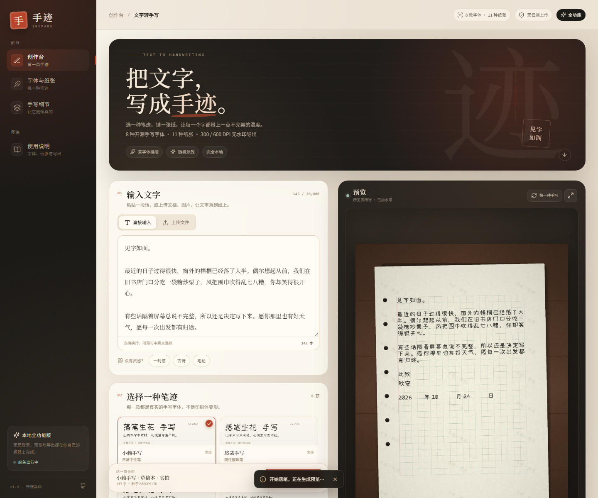
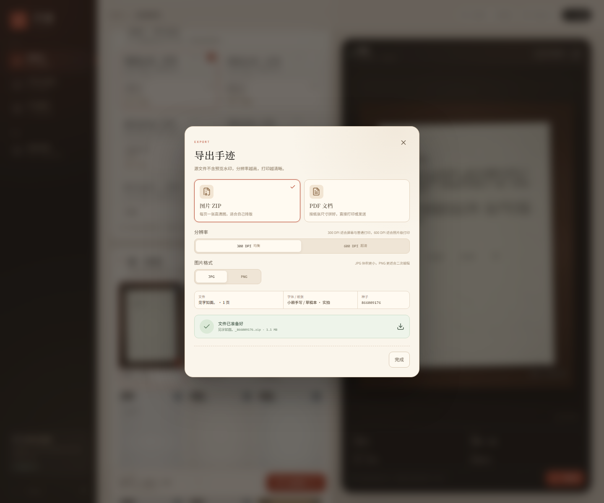

# 手迹 InkMark

> 一个完整、可本地运行的「文字 → 手写稿」工作台。
> 不是调用 AI 画字，而是把开源手写字体、纸张纹理、字格排版和随机瑕疵组合成一张真正像手写的纸。






---

## 为什么是“完整版”

这不是一个只画 `fillText` 的 demo。当前版本包含：

| 能力 | 实现 |
| --- | --- |
| 文字输入 | 粘贴、换行、段落、中英文混排 |
| Word | `.docx` 段落、表格文字提取；服务端解析 |
| PDF | 文字层提取；扫描版 PDF 自动逐页 OCR |
| 图片 | PNG / JPG / WebP OCR |
| 字体 | 8 款真实手写字体，服务端栅格化 |
| 纸张 | 11 种纸张：实拍桌面、信纸、格子纸、考试纸、牛皮纸、旧信笺、点阵本 |
| 排版 | 中文字格、标点避头尾、长英文断行、自动分页、最多 12 页 |
| 随机性 | 位置抖动、笔画抖动、旋转、字号变化、随机涂改/划线 |
| 可复现 | 固定 seed，预览与下载使用同一份布局 |
| 预览 | 服务端渲染低分辨率 JPG，带平铺水印 |
| 下载 | 高清无水印 ZIP（JPG/PNG）或 PDF，300 / 600 DPI |
| 工程 | 异步任务、轮询进度、文件过期清理、限流、上传校验、大小限制 |
| UI | 响应式中文界面、字体/纸张缩略图、页面翻页、点击放大、OCR 结果可编辑后重新生成 |

没有为了“能跑”而砍掉 PDF/OCR/Word/600DPI/异步任务；这些都在仓库里。

> 没有复刻登录、卡密、支付、管理后台——那是原站的商业运营系统，不是文字转手写的核心能力。本项目的导出没有付费墙。

---

## 快速开始（Windows）

要求：Python 3.11+、Node.js 20+、pnpm 或 npm。

```powershell
cd D:\vibecoding\inkmark

# 1. 安装后端依赖、字体、前端依赖并构建
powershell -ExecutionPolicy Bypass -File scripts\setup.ps1

# 2. 启动
powershell -ExecutionPolicy Bypass -File scripts\run.ps1
```

打开 <http://127.0.0.1:8420>。

### 手动启动

```powershell
cd backend
python -m venv .venv
.\.venv\Scripts\python -m pip install -r requirements.txt
powershell -ExecutionPolicy Bypass -File ..\scripts\download_fonts.ps1

cd ..\frontend
pnpm install --ignore-scripts
pnpm build

cd ..\backend
.\.venv\Scripts\python -m uvicorn app.main:app --host 127.0.0.1 --port 8420
```

### 前端开发模式

```powershell
# 终端 1
cd backend
.\.venv\Scripts\python -m uvicorn app.main:app --host 127.0.0.1 --port 8420 --reload

# 终端 2
cd frontend
pnpm dev
```

Vite 在 `http://127.0.0.1:5173`，并把 `/api` 代理到 `8420`。

---

## 它到底怎么画出一页手迹

```text
文本 ─────────────────────────────┐
Word (.docx) ── python-docx ──────┤
PDF ── PyMuPDF 文字层 ────────────┤
扫描 PDF / 图片 ── RapidOCR ──────┘
                                  ↓
                    FastAPI 创建异步任务
                                  ↓
   字格排版 → 逐字随机变换 → 纸张纹理 → 墨迹合成
                                  ↓
                 预览 JPG（加水印）/ layout.json
                                  ↓
                ZIP / PDF（300 或 600 DPI，无水印）
```

### 1. 布局：先有格子，再写字

`backend/app/layout.py` 会按纸张模板计算：

- 页面尺寸、纸张区域、四边留白；
- 每行字数、行高、字号；
- 段落缩进、空行、标点避头尾；
- 英文单词整体换行，超长单词才拆；
- 分页与 12 页上限。

每个字都会生成一条 `Glyph`：

```json
{
  "ch": "山",
  "x": 244.0,
  "y": 315.7,
  "size": 64.8,
  "angle": 1.2,
  "alpha": 0.94,
  "warp": 0.05,
  "scribble": false,
  "seed": 42
}
```

布局坐标保存在 `layout.json`，**预览和高清导出使用的是同一份布局**。所以不会出现“预览一个样、下载另一个样”。

### 2. 随机：三档“不完美”

| 参数 | 作用 | 默认 |
| --- | --- | --- |
| 文字位置凌乱 | 字在字格内的 x/y 偏移、整行基线漂移 | 6% |
| 笔画抖动 | 每个字的旋转、缩放、局部笔画扭曲 | 5% |
| 随机涂改 | 按概率在字上画叉、圈、折线 | 3% |

随机数由 `seed` 派生到每个字，因此：

```python
random.Random(f"{seed}:glyph:{page}:{index}")
```

同一个 seed 在任何机器、任何 DPI 下都会得到同样的位置和笔画参数。

### 3. 纸张：程序生成的实拍质感

`backend/app/papers.py` 生成：

- 纸纤维、细颗粒、边缘暗角；
- 木桌木纹、纸张阴影、线圈装订孔；
- 红/黑格子、横线、点阵、考试纸页眉；
- 旧信笺水渍、牛皮纸折痕。

“实拍”系列会先把纸页渲染出来，再带一点旋转和阴影贴到桌面上；文字在纸页坐标系里排版，不会跑到桌面上。

### 4. 墨迹：不是纯黑贴图

`backend/app/renderer.py` 对每个字：

1. 用 FreeType 字体渲染一张 alpha 蒙版；
2. 按 `warp` 做逐行正弦位移，模拟笔画抖动；
3. 按角度旋转、按字号缩放；
4. 用墨色 + 透明度贴回纸面；
5. 按概率叠加涂改线。

字体缺字会留空并在任务 warning 里提示，不会偷偷 fallback 成印刷体。

---

## 目录结构

```text
inkmark/
├─ backend/
│  ├─ app/
│  │  ├─ main.py        # FastAPI 路由、静态前端、限流
│  │  ├─ jobs.py        # 异步预览/导出、进度
│  │  ├─ layout.py      # 中文字格排版、分页
│  │  ├─ renderer.py    # 字体栅格化、墨迹、水印
│  │  ├─ papers.py      # 纸张/桌面纹理
│  │  ├─ extract.py     # docx / PDF / 图片 OCR
│  │  ├─ exports.py     # ZIP / PDF
│  │  ├─ catalog.py     # 字体、纸张、参数
│  │  └─ fonts.py       # 字体加载、缺字检测、样张
│  ├─ assets/fonts/     # 8 款开源字体
│  ├─ assets/licenses/  # OFL 协议
│  └─ tests/            # pytest
├─ frontend/
│  ├─ src/components/   # 输入、字体、纸张、预览、导出弹窗
│  └─ dist/             # 构建产物（FastAPI 直接托管）
├─ scripts/
│  ├─ setup.ps1
│  ├─ run.ps1
│  └─ download_fonts.ps1
├─ data/
│  ├─ cache/            # 字体样张、纸张缩略图、纸张底图
│  └─ jobs/             # 任务、预览、导出文件（24h 清理）
└─ docs/
```

---

## API 一览

| 方法 | 路径 | 说明 |
| --- | --- | --- |
| GET | `/api/health` | 健康检查 |
| GET | `/api/catalog` | 字体、纸张、墨色、参数范围、示例文本 |
| GET | `/api/assets/fonts/{id}/sample.png` | 字体样张 |
| GET | `/api/assets/papers/{id}/thumb.jpg` | 纸张缩略图 |
| POST | `/api/jobs` | 创建任务，`multipart/form-data` |
| GET | `/api/jobs/{id}` | 任务状态、预览地址、进度 |
| GET | `/api/jobs/{id}/preview/{n}` | 带水印预览 JPG |
| POST | `/api/jobs/{id}/exports` | 创建导出 `{format, dpi, image_format}` |
| GET | `/api/jobs/{id}/exports/{eid}` | 导出进度 |
| GET | `/api/jobs/{id}/exports/{eid}/file` | 下载 ZIP/PDF |
| DELETE | `/api/jobs/{id}` | 删除任务 |

创建任务字段：

```text
mode=text|file
text=...
file=@...
font_id=xiaolai
paper_id=notebook
font_size=1.0
line_spacing=1.0
messiness=6
stroke_random=5
mistake_rate=3
slant=0
ink=#1f1e1b
seed=20261024
```

---

## 字体与授权

字体文件仅在服务端使用，不通过前端暴露。

| 字体 | 风格 | 来源 | 授权 |
| --- | --- | --- | --- |
| 小赖手写 | 日常中性笔 | [lxgw/kose-font](https://github.com/lxgw/kose-font) | SIL OFL 1.1 |
| 悠哉手写 | 随性圆珠笔 | [lxgw/yozai-font](https://github.com/lxgw/yozai-font) | SIL OFL 1.1 |
| 马善政毛笔 | 毛笔楷书 | [Google Fonts](https://fonts.google.com/specimen/Ma+Shan+Zheng) | SIL OFL 1.1 |
| 志莽行书 | 行书 | [Google Fonts](https://fonts.google.com/specimen/Zhi+Mang+Xing) | SIL OFL 1.1 |
| 龙藏体 | 清瘦行楷 | [Google Fonts](https://fonts.google.com/specimen/Long+Cang) | SIL OFL 1.1 |
| 刘建毛草 | 草书 | [Google Fonts](https://fonts.google.com/specimen/Liu+Jian+Mao+Cao) | SIL OFL 1.1 |
| 辰宇落雁 | 细笔文艺 | [Chenyu-otf](https://github.com/Chenyu-otf/chenyuluoyan_thin) | SIL OFL 1.1 |
| 霞鹜文楷 | 工整楷体 | [lxgw/LxgwWenKai](https://github.com/lxgw/LxgwWenKai) | SIL OFL 1.1 |

纸张和桌面纹理由代码生成，不包含原站素材。

> 辰宇落雁体原文件的 TrueType hinting 在 FreeType 下会触发 `too many function definitions`。仓库中的版本移除了 `fpgm/prep/cvt/gasp/DSIG` 表，保留字形轮廓，属于 OFL 允许的修改。

---

## 配置与限制

| 项 | 默认值 | 环境变量 |
| --- | --- | --- |
| 最大字符 | 20,000 | `INKMARK_MAX_CHARS` |
| 最大页数 | 12 | `INKMARK_MAX_PAGES` |
| 上传大小 | 20 MB | `INKMARK_MAX_UPLOAD_MB` |
| 任务保留 | 24 小时 | `INKMARK_JOB_TTL_HOURS` |
| 预览宽度 | 1400 px | `INKMARK_PREVIEW_WIDTH` |
| 数据目录 | `data/` | `INKMARK_DATA_DIR` |
| 频率限制 | 30 次 / 10 分钟 / IP | 见 `main.py` |

已知边界：

- 旧版 `.doc` 需要 LibreOffice/antiword 才能解析，本项目只接受 `.docx`；这是格式支持范围，不是把功能藏起来。
- PDF 最多解析 80 页；输出最多 12 页。
- 600 DPI 是真实高分辨率渲染，不是放大；一页 A4 约 4960×7015，内存和 CPU 会明显高于 300 DPI。
- 特殊生僻字取决于字体覆盖；缺字会留空并提示。
- 这是一台单机服务，任务队列是进程内 `ThreadPoolExecutor`；多机部署应换成 Redis/RQ/Celery + 对象存储。

---

## 测试

```powershell
cd backend
.\.venv\Scripts\python -m pytest -q
```

当前覆盖：

- 字格 20×20、400 字/页分页；
- 固定 seed 的布局可复现；
- 标点不落到行首；
- 缺字提示；
- 长文本分页；
- PDF 物理尺寸（不因 DPI 变成 656mm 的巨页）；
- ZIP 内容；
- Word 段落/表格；
- OCR（标记为 slow，可单独跑）；
- API 创建任务、轮询预览、删除任务。

---

## 二次开发

### 加一款字体

1. 把 `.ttf/.otf` 放进 `backend/assets/fonts/`；
2. 在 `backend/app/catalog.py` 的 `FONTS` 里加一条 `FontSpec`；
3. 确认授权允许服务端嵌入/栅格化；
4. 重启后端。

### 加一张纸

在 `PAPERS` 里加 `PaperSpec`，并在 `papers.py` 的 `CANONICAL_SHEET` / `_decorate_sheet` 支持新的 `kind`。

### 调整排版

- `font_ratio`：字号相对纸宽；
- `line_spacing`：行距；
- `margin_x/top/bottom`：留白；
- `cols/rows`：字格。

---

## 使用边界

这个项目适合做：个性化信纸、手写风格贺卡、排版实验、教学演示、笔记生成。

请不要用来伪造签名、伪造公文、代写作业/考试，或冒充他人笔迹。字体和纸张素材也有各自的授权边界。

## License

代码：MIT（见 `LICENSE`）。
字体：各自 SIL OFL 1.1，见 `backend/assets/licenses/` 与上表。
